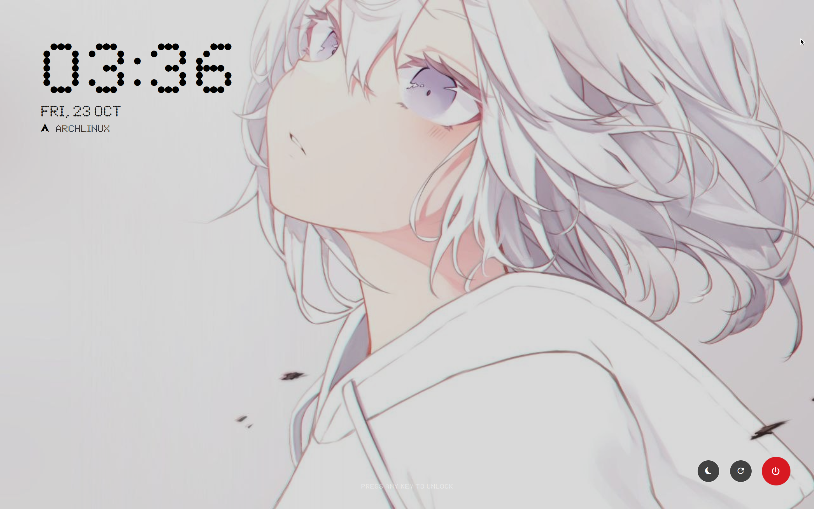

# glyph sddm

a high-end, minimalist SDDM theme inspired by the **Nothing Phone** aesthetic. Featuring authentic dot-matrix typography, intelligent adaptive coloring, and premium "obsidian glass" interactions.

<div align="center">
  
</div>

## 🛠 configuration & Testing

### preview without logging out
run this command to preview the theme:
```bash
sddm-greeter-qt6 --test-mode --theme /usr/share/sddm/themes/glyph
```

### customization
edit `theme.conf` or replace assets in `assets/images/`:
- **wallpaper:** replace `assets/images/background.jpg`.
- **avatar:** replace `assets/images/avatar.jpg`.
- **clock Format:** set `use24HourClock=true` in `theme.conf` to switch to a 24-hour clock, or `use24HourClock=false` for 12-hour.

## 🤝 credits

- **author:** [xCaptaiN09](https://github.com/xCaptaiN09)
- **design:** inspired by Nothing Phone (1) & (2).
- **fonts:** ndot 57 Aligned & Symbols Nerd Font (included).
